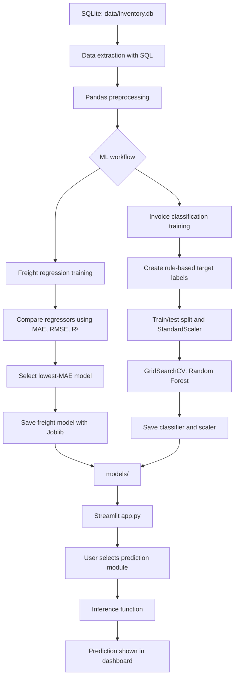
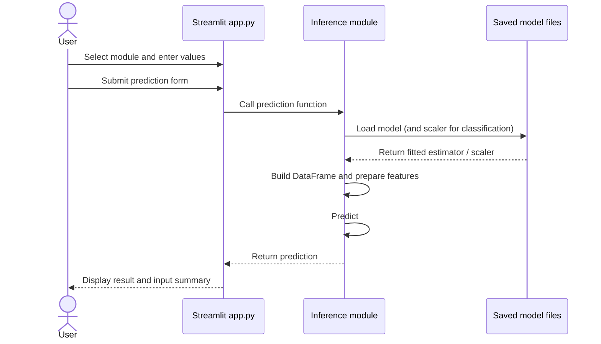
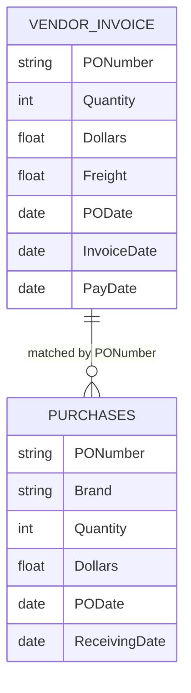
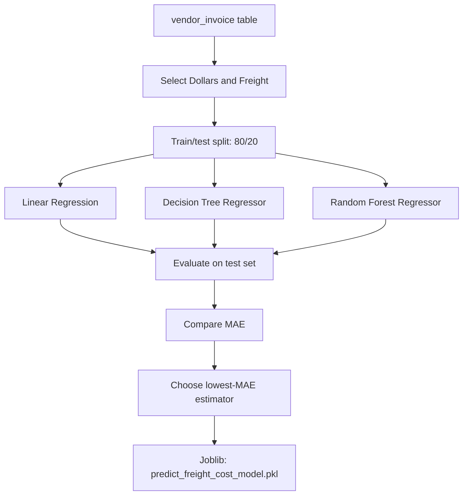
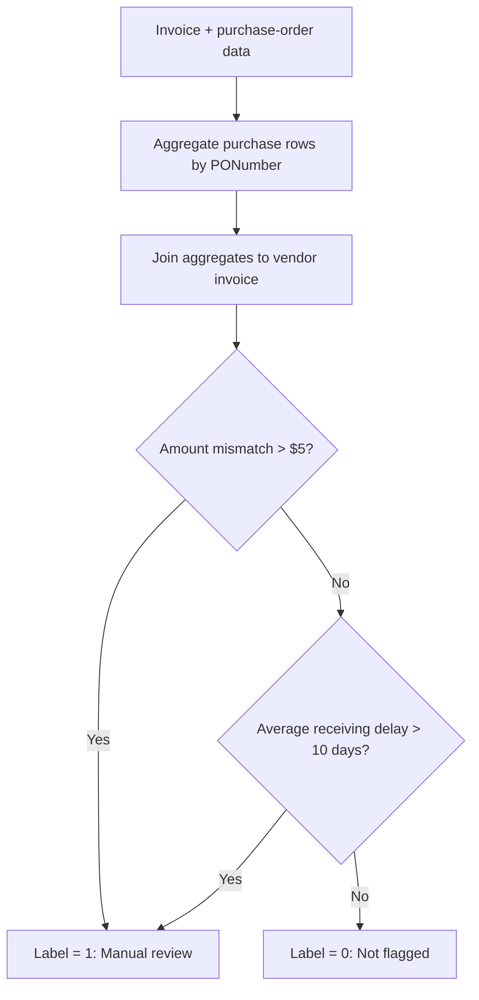
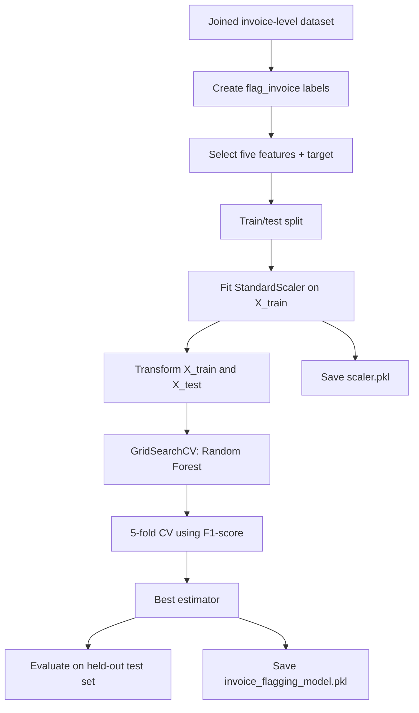

# Invoice Intelligence Dashboard

A machine-learning-powered invoice analytics application built with **Python**, **Streamlit**, **Pandas**, **SQLite**, and **Scikit-learn**. The project provides two decision-support workflows:

1. **Freight Cost Prediction** — estimates freight cost from an invoice amount using a regression model.
2. **Invoice Risk Assessment** — classifies an invoice as approved or requiring manual review using a Random Forest classifier.

> **Important:** This is an educational/prototype decision-support project. A model prediction is not proof of fraud and must not replace financial controls or human approval.

<p align="center">
  <a href="https://invoice-intelligence-hregkedqlwwk4rut9wejhb.streamlit.app/"><strong>🚀 Live Streamlit App</strong></a>
  ·
  <a href="https://github.com/Surajgupta001/Invoice-Intelligence"><strong>📦 Source Code</strong></a>
</p>

---

## Table of Contents

- [Project Overview](#-project-overview)
- [Problem Statement](#-problem-statement)
- [Key Features](#-key-features)
- [Application Demo](#-application-demo)
- [System Architecture](#-system-architecture)
- [Technology Stack](#-technology-stack)
- [Repository Structure](#-repository-structure)
- [Dataset and Data Model](#-dataset-and-data-model)
- [Module 1: Freight Cost Prediction](#-module-1-freight-cost-prediction)
- [Module 2: Invoice Risk Assessment](#-module-2-invoice-risk-assessment)
- [Model Training and Evaluation](#-model-training-and-evaluation)
- [Inference Workflow](#-inference-workflow)
- [Installation and Setup](#-installation-and-setup)
- [Running the Application](#-running-the-application)
- [Training the Models](#-training-the-models)
- [Input and Output Reference](#-input-and-output-reference)
- [Configuration and Model Artifacts](#-configuration-and-model-artifacts)
- [Limitations and Responsible Use](#-limitations-and-responsible-use)
- [Troubleshooting](#-troubleshooting)
- [Future Improvements](#-future-improvements)
- [Contributing](#-contributing)
- [License](#-license)
- [Author](#-author)

---

## 📌 Project Overview

Invoice Intelligence is a Streamlit web application that demonstrates how machine learning can support invoice processing. It separates the workflow into two independent ML tasks:

| Module                  | ML task               | Model used by the training pipeline                                                                      | Prediction                         |
| ----------------------- | --------------------- | -------------------------------------------------------------------------------------------------------- | ---------------------------------- |
| Freight Cost Prediction | Regression            | Best of Linear Regression, Decision Tree Regressor, and Random Forest Regressor (selected by lowest MAE) | A continuous freight-cost estimate |
| Invoice Risk Assessment | Binary classification | Random Forest Classifier tuned with GridSearchCV                                                         | Class 0 or Class 1                 |

The application loads previously trained model artifacts from the `models/` directory. It does **not** train models every time a user opens the dashboard.

### Project goals

- Estimate expected freight costs from historical invoice information.
- Highlight invoices that meet defined risk conditions.
- Reduce repetitive manual checking and support prioritization.
- Demonstrate a complete ML workflow: data extraction, preprocessing, training, evaluation, persistence, inference, and user interface.

## 🎯 Problem Statement

Finance and procurement teams process invoices containing item values, quantities, freight charges, purchase-order information, and payment dates. Reviewing every record manually can be slow and can make inconsistencies harder to prioritize.

This project explores two focused questions:

1. Given an invoice amount, what freight cost does the trained regression model estimate?
2. Given invoice and purchase-summary values, does the trained classifier identify the invoice as a candidate for manual review?

The application provides predictions to assist a reviewer. Final approval remains a human/business decision.

## ✨ Key Features

- **Freight estimation:** predicts freight cost from the invoice amount.
- **Invoice flagging:** predicts whether an invoice should be reviewed manually.
- **Interactive forms:** collects inputs through Streamlit.
- **Reusable model artifacts:** loads trained models using Joblib.
- **SQLite data source:** training data is queried from the local inventory database.
- **Feature scaling:** the classification workflow saves and reuses a fitted StandardScaler.
- **Model comparison:** freight regressors are compared using MAE, RMSE, and R².
- **Hyperparameter search:** the classification training pipeline uses GridSearchCV with F1-score and 5-fold cross-validation.
- **Input summary:** displays the values submitted by the user after prediction.

## 🌐 Application Demo

**Live application:** [Invoice Intelligence Dashboard](https://invoice-intelligence-hregkedqlwwk4rut9wejhb.streamlit.app/)

The sidebar lets the user choose between the two prediction modules.

### 1. Freight Cost Prediction

1. Open **Freight Cost Prediction** from the sidebar.
2. Enter the quantity and invoice amount.
3. Select **Predict Freight Cost**.
4. Review the estimated freight amount and submitted-input summary.

**Implementation detail:** the current freight model is trained with the `Dollars` feature only. The quantity field is currently collected and shown in the input summary, but it is not passed to the regression model.

### 2. Invoice Manual Approval

1. Open **Invoice Manual Approval** from the sidebar.
2. Enter invoice quantity, invoice amount, freight, total item quantity, and total item amount.
3. Select **Predict Invoice Flag**.
4. Review the predicted status:
   - `0` → Invoice Approved (low-risk prediction)
   - `1` → Manual Approval Required (high-risk prediction)

These labels describe the model output, not a verified fraud determination.

## 🏛️ System Architecture

The following diagram shows the overall development and runtime lifecycle.



### Runtime request flow



## 🧰 Technology Stack

| Technology           | Role in this project                                                       |
| -------------------- | -------------------------------------------------------------------------- |
| Python 3.11+         | Main programming language                                                  |
| Streamlit            | Interactive web application                                                |
| Pandas               | Data extraction, tabular transformation, and input DataFrames              |
| NumPy                | Numerical computing dependency                                             |
| SQLite               | Local relational database used for training data                           |
| Scikit-learn         | Regression, classification, preprocessing, model selection, and evaluation |
| Joblib               | Saving and loading trained estimators and scaler                           |
| Matplotlib / Seaborn | Exploratory data analysis and notebook visualizations                      |
| Plotly               | Visualization library included in project dependencies                     |
| Jupyter / IPython    | Notebook-based exploration and experiments                                 |
| SciPy                | Scientific-computing dependency                                            |
| uv                   | Environment and dependency management (recommended)                        |

## 📁 Repository Structure

The key files are organized as follows (some generated or data files may not be included in every clone/deployment):

```text
Invoice-Intelligence/
│
├── app.py
│
├── data/
│   └── inventory.db
│
├── Inference/
│   ├── predict_freight.py
│   └── predict_invoice_flag.py
│
├── Invoice Flagging/
│   ├── data_preprocessing.py
│   ├── model_evaluation.py
│   └── train.py
│
├── Predicting Freight Cost/
│   ├── data_preprocessing.py
│   ├── model_evaluation.py
│   └── train.py
│
├── models/
│   ├── predict_freight_cost_model.pkl
│   ├── invoice_flagging_model.pkl
│   └── scaler.pkl
│
├── notebooks/
│   ├── Invoice Flagging.ipynb
│   └── Predicting Freight Cost.ipynb
│
├── pyproject.toml
├── uv.lock
├── .python-version
└── README.md
```

### Important files

| File                                            | Responsibility                                                                                    |
| ----------------------------------------------- | ------------------------------------------------------------------------------------------------- |
| `app.py`                                        | Streamlit page configuration, navigation, forms, calls to inference functions, and result display |
| `Predicting Freight Cost/data_preprocessing.py` | Reads `vendor_invoice`, selects `Dollars` as X and `Freight` as y, and splits data                |
| `Predicting Freight Cost/model_evaluation.py`   | Trains and evaluates the three regression algorithms                                              |
| `Predicting Freight Cost/train.py`              | Runs the freight training workflow and saves the lowest-MAE model                                 |
| `Invoice Flagging/data_preprocessing.py`        | Joins invoice and purchase summaries, creates target labels, splits data, and scales features     |
| `Invoice Flagging/model_evaluation.py`          | Defines Random Forest GridSearchCV and classifier evaluation                                      |
| `Invoice Flagging/train.py`                     | Runs classification training and saves the classifier and scaler                                  |
| `Inference/predict_freight.py`                  | Loads the freight model and returns freight predictions                                           |
| `Inference/predict_invoice_flag.py`             | Loads the classifier and scaler, validates required inputs, and returns invoice flags             |
| `models/`                                       | Stores serialized model and preprocessing artifacts                                               |
| `notebooks/`                                    | Contains exploratory analysis and model experiments                                               |
| `data/inventory.db`                             | SQLite source database expected by the training scripts                                           |
| `pyproject.toml`                                | Python project metadata and dependencies                                                          |
| `uv.lock`                                       | Locked dependency resolution, when present                                                        |

## 🗃️ Dataset and Data Model

The training workflows use a local SQLite database at `data/inventory.db`.

The SQL in the project expects two tables:

- `vendor_invoice`: invoice-level information.
- `purchases`: purchase-order line/item information.

### Important source fields

| Table            | Field           | Usage                                         |
| ---------------- | --------------- | --------------------------------------------- |
| `vendor_invoice` | `PONumber`      | Connects an invoice to its purchase order     |
| `vendor_invoice` | `Quantity`      | Invoice quantity                              |
| `vendor_invoice` | `Dollars`       | Invoice amount                                |
| `vendor_invoice` | `Freight`       | Regression target and classifier input        |
| `vendor_invoice` | `InvoiceDate`   | Used to calculate PO-to-invoice duration      |
| `vendor_invoice` | `PODate`        | Purchase-order date                           |
| `vendor_invoice` | `PayDate`       | Used to calculate invoice-to-payment duration |
| `purchases`      | `PONumber`      | Groups purchase rows by purchase order        |
| `purchases`      | `Brand`         | Used to count distinct brands                 |
| `purchases`      | `Quantity`      | Used to aggregate ordered item quantity       |
| `purchases`      | `Dollars`       | Used to aggregate item-level amount           |
| `purchases`      | `ReceivingDate` | Used to calculate receiving delay             |
| `purchases`      | `PODate`        | Used with receiving date to calculate delay   |

### Data extraction and purchase aggregation

The invoice-flagging SQL uses a common table expression (CTE) to aggregate purchase rows by purchase order:

```sql
WITH purchase_agg AS (
    SELECT
        PONumber,
        COUNT(DISTINCT Brand) AS total_brands,
        SUM(Quantity) AS total_item_quantity,
        SUM(Dollars) AS total_item_dollars,
        AVG(
            julianday(ReceivingDate) - julianday(PODate)
        ) AS avg_receiving_delay
    FROM purchases
    GROUP BY PONumber
)
```

It then joins these aggregates to `vendor_invoice` using `PONumber`. This creates invoice-level features that can be compared with the purchase-order summary.

### Data relationship



The diagram represents the logical join used by the query. It is not a claim that database foreign-key constraints are declared.

## 🚚 Module 1: Freight Cost Prediction

### Objective

Estimate the freight charge associated with an invoice using a regression model.

### ML task

**Supervised regression**

- Input feature (X): `Dollars`
- Target (y): `Freight`
- Prediction: estimated freight cost

The current feature preparation code is equivalent to:

```python
X = df[["Dollars"]]
y = df["Freight"]
```

### Training workflow

1. Connect to SQLite and read the `vendor_invoice` table.
2. Select invoice amount as the input feature.
3. Select freight as the target.
4. Split the data into training and testing sets (80% / 20%, with `random_state=42`).
5. Train three candidate regressors.
6. Evaluate each model on the test set.
7. Select the model with the lowest Mean Absolute Error.
8. Save the selected estimator to `models/predict_freight_cost_model.pkl`.



### Candidate algorithms

| Algorithm               | Description                                                   |
| ----------------------- | ------------------------------------------------------------- |
| Linear Regression       | Fits a linear relationship between invoice amount and freight |
| Decision Tree Regressor | Learns threshold-based splits to predict a continuous value   |
| Random Forest Regressor | Combines predictions from multiple decision trees             |

The current training script chooses the candidate with the **lowest MAE**. The selected model is not hard-coded to always be Linear Regression; it is determined when the training script runs.

### Regression evaluation metrics

Let (y_i) be the actual freight value, \hat{y}\_i the predicted value, and (n) the number of test samples.

**Mean Absolute Error (MAE)**

`MAE = (1/n) × Σ |yᵢ - ŷᵢ|`

Measures average absolute prediction error. Lower is better.

**Root Mean Squared Error (RMSE)**

`RMSE = sqrt((1/n) × Σ (yᵢ - ŷᵢ)²)`

Penalizes larger errors more strongly than MAE. Lower is better.

**R-squared (R²)**

`R² = 1 - [Σ(yᵢ - ŷᵢ)² / Σ(yᵢ - ȳ)²]`

Measures the proportion of target variance explained by the model. A value closer to 1 generally indicates a better fit, but it should be interpreted with the test-set context.

### Prediction example

The Streamlit form collects quantity and invoice amount. The inference function currently sends only the invoice amount to the model:

```python
input_data = {"Dollars": [dollars]}
prediction = predict_freight_cost(input_data)[0]
```

The model returns a predicted freight value, which the dashboard displays as an estimated currency amount.

## 🚩 Module 2: Invoice Risk Assessment

### Objective

Classify an invoice into one of two model-defined outcomes:

| Encoded label | Dashboard message                    | Interpretation                                |
| ------------- | ------------------------------------ | --------------------------------------------- |
| `0`           | Invoice Approved / Low Risk          | The classifier did not flag the invoice       |
| `1`           | Manual Approval Required / High Risk | The classifier flagged the invoice for review |

This is a **binary classification** task. The output is a screening recommendation, not proof that an invoice is fraudulent.

### Feature engineering

The preprocessing workflow joins invoice data with purchase aggregates and derives fields such as:

- `invoice_quantity`
- `invoice_dollars`
- `Freight`
- `days_po_to_invoice`
- `days_to_pay`
- `total_brands`
- `total_item_quantity`
- `total_item_dollars`
- `avg_receiving_delay`

The current training script uses the following **five model features**:

```python
FEATURES = [
    "invoice_quantity",
    "invoice_dollars",
    "Freight",
    "total_item_quantity",
    "total_item_dollars",
]
TARGET = "flag_invoice"
```

Other derived columns are available during preprocessing but are not included in this current model's feature list.

### Rule-based target-label creation

The project creates its training target with business rules in `create_invoice_risk_label()`:

1. If the absolute difference between invoice amount and aggregated item amount is greater than 5, assign label `1`.
2. Otherwise, if average receiving delay is greater than 10 days, assign label `1`.
3. Otherwise, assign label `0`.

Conceptually:

```python
if abs(invoice_dollars - total_item_dollars) > 5:
    flag_invoice = 1
elif avg_receiving_delay > 10:
    flag_invoice = 1
else:
    flag_invoice = 0
```

The thresholds are business-rule assumptions encoded in the project. They should be validated with domain experts before production use.

### Label generation flow



### Preprocessing and scaling

The classification workflow:

1. Creates labels using the rule function.
2. Selects the five features and target.
3. Splits data into training and test partitions (80% / 20%, `random_state=42`).
4. Fits `StandardScaler` on the training features only.
5. Transforms both training and test features with that fitted scaler.
6. Saves the scaler to `models/scaler.pkl`.

Standardization uses:

`z = (x - mean) / standard_deviation`

The mean and standard deviation are learned from training data. The same fitted scaler must be reused at inference time; fitting a new scaler on each user request would make the model inputs inconsistent.

### Random Forest classifier

The classifier is an ensemble of decision trees. Each tree produces a class prediction, and the forest combines the tree predictions to produce the final class.

The project uses `RandomForestClassifier` and tunes these hyperparameters:

| Hyperparameter      | Values explored | Meaning                                |
| ------------------- | --------------- | -------------------------------------- |
| `n_estimators`      | 100, 200, 300   | Number of trees                        |
| `max_depth`         | None, 4, 5, 6   | Maximum depth of each tree             |
| `min_samples_split` | 2, 3, 5         | Minimum samples needed to split a node |
| `min_samples_leaf`  | 1, 2, 5         | Minimum samples allowed in a leaf      |
| `criterion`         | gini, entropy   | Split-quality measure                  |

The current grid contains 216 parameter combinations. With 5-fold cross-validation, GridSearchCV evaluates 1,080 model fits before refitting the best configuration on the full training partition.

### Classification evaluation

The evaluation code reports:

- **Accuracy:** fraction of all predictions that are correct.
- **Precision:** among invoices predicted as flagged, the fraction that are actually flagged.
- **Recall:** among actually flagged invoices, the fraction identified by the model.
- **F1-score:** harmonic mean of precision and recall.
- **Confusion matrix:** counts of true negatives, false positives, false negatives, and true positives.

The GridSearchCV selection metric is **F1-score**. This balances precision and recall and can be more informative than accuracy when class frequencies are unequal.

### Classification workflow



## 📏 Model Training and Evaluation

The project separates model development from model serving.

| Stage           | Freight workflow                      | Invoice-risk workflow                                 |
| --------------- | ------------------------------------- | ----------------------------------------------------- |
| Data source     | `vendor_invoice`                      | `vendor_invoice` joined with aggregated `purchases`   |
| Target          | `Freight`                             | `flag_invoice`                                        |
| Features        | `Dollars`                             | Five features listed above                            |
| Split           | 80/20, random state 42                | 80/20, random state 42                                |
| Candidate/model | Three regressors; lowest MAE selected | Random Forest with GridSearchCV                       |
| Evaluation      | MAE, RMSE, R²                         | Accuracy, classification report, confusion matrix, F1 |
| Artifacts       | Freight estimator                     | Classifier and StandardScaler                         |

### Reproducing evaluation

Run the training scripts using the commands in [Training the Models](#-training-the-models). The scripts print evaluation results to the terminal. Use the output from the **current run and current saved artifacts** when reporting model performance.

> Historical notebook scores and results from a previous run should not automatically be presented as the performance of the currently saved model. Dataset versions, features, random splits, and tuned parameters can change results.

## 🔮 Inference Workflow

Inference means using an already-trained model to make a prediction for new input. The Streamlit application calls the functions in the `Inference/` directory.

### Freight inference

File: `Inference/predict_freight.py`

1. Load `predict_freight_cost_model.pkl` with Joblib.
2. Convert the input dictionary into a Pandas DataFrame.
3. Pass the DataFrame to `model.predict()`.
4. Round the returned prediction.
5. Return the prediction as a list.

### Invoice-risk inference

File: `Inference/predict_invoice_flag.py`

1. Load `invoice_flagging_model.pkl`.
2. Convert the input dictionary into a DataFrame.
3. Check that all five required feature columns are present.
4. Load `scaler.pkl`.
5. Transform the five features using the saved scaler.
6. Pass the scaled values to the classifier.
7. Add `Predicted_Invoice_Flag` to the returned DataFrame.

### Why are the model and scaler both saved?

The classifier was trained on standardized data. Therefore, new input must be standardized with the **same fitted scaler** before it is passed to the classifier. The model and scaler together form the classification inference pipeline.

## 💻 Installation and Setup

### Prerequisites

- Python **3.11 or later**.
- Git.
- Access to the project SQLite database at `data/inventory.db` for model retraining.
- The saved model artifacts in `models/` for running predictions.

### 1. Clone the repository

```bash
git clone https://github.com/Surajgupta001/Invoice-Intelligence.git
cd Invoice-Intelligence
```

### 2. Create and activate a virtual environment

**Windows PowerShell**

```powershell
python -m venv .venv
.\.venv\Scripts\Activate.ps1
```

**Windows Command Prompt**

```bat
python -m venv .venv
.venv\Scripts\activate.bat
```

**Linux / macOS**

```bash
python3 -m venv .venv
source .venv/bin/activate
```

### 3. Install dependencies

The repository contains a `pyproject.toml` and `uv.lock`. With uv installed, use:

```bash
uv sync
```

Alternatively, after activating a virtual environment, install the project and its declared dependencies with:

```bash
python -m pip install .
```

If you use the pip route and run into an environment-specific missing-package error, install the missing package in that environment and keep the project dependency declaration in sync.

## ▶️ Running the Application

From the repository root, run:

```bash
streamlit run app.py
```

Or with uv:

```bash
uv run streamlit run app.py
```

Streamlit prints a local URL (usually `http://localhost:8501`). Open it in a browser.

### Required runtime artifacts

Confirm that these files exist before launching the app:

```text
models/
├── predict_freight_cost_model.pkl
├── invoice_flagging_model.pkl
└── scaler.pkl
```

The dashboard requires the freight model for freight predictions and both the classifier and scaler for invoice-risk predictions.

## 🏋️ Training the Models

Training requires the SQLite database and its expected tables/columns.

> **Run each training script from its own module directory.** The current scripts use relative database paths such as `../data/inventory.db`; running them from the repository root may cause the database path to resolve incorrectly.

### Train the freight model

**Windows PowerShell / Command Prompt**

```powershell
cd "Predicting Freight Cost"
python train.py
cd ..
```

**Linux / macOS**

```bash
cd "Predicting Freight Cost"
python train.py
cd ..
```

This script trains the candidate regressors, prints their test metrics, selects the lowest-MAE model, and saves:

```text
models/predict_freight_cost_model.pkl
```

### Train the invoice-risk model

```bash
cd "Invoice Flagging"
python train.py
cd ..
```

This script creates labels, splits and scales the data, performs Random Forest hyperparameter search, evaluates the best estimator, and saves:

```text
models/
├── invoice_flagging_model.pkl
└── scaler.pkl
```

### Training versus application startup

- **Training:** reads historical data, fits models, evaluates them, and writes model artifacts.
- **Inference:** loads those artifacts and predicts new inputs.
- **Dashboard startup:** launches the Streamlit interface; it does not automatically retrain models.

## 🧾 Input and Output Reference

### Freight Cost Prediction

| Input                      | Type             |    Used by model? | Notes                                          |
| -------------------------- | ---------------- | ----------------: | ---------------------------------------------- |
| Quantity                   | Positive integer | No, not currently | Collected for display in the current form      |
| Invoice Amount (`Dollars`) | Numeric          |               Yes | Sole feature used by the current freight model |

**Output:** rounded estimated freight cost.

### Invoice Risk Assessment

| Input                                       | Type    | Used by model? |
| ------------------------------------------- | ------- | -------------: |
| Invoice Quantity (`invoice_quantity`)       | Numeric |            Yes |
| Invoice Amount (`invoice_dollars`)          | Numeric |            Yes |
| Freight (`Freight`)                         | Numeric |            Yes |
| Total Item Quantity (`total_item_quantity`) | Numeric |            Yes |
| Total Item Amount (`total_item_dollars`)    | Numeric |            Yes |

**Output:** `Predicted_Invoice_Flag` with class `0` or `1`.

## 📦 Configuration and Model Artifacts

| Artifact                         | Description                                      |
| -------------------------------- | ------------------------------------------------ |
| `predict_freight_cost_model.pkl` | Selected freight regression estimator            |
| `invoice_flagging_model.pkl`     | Tuned Random Forest classifier                   |
| `scaler.pkl`                     | Fitted StandardScaler used before classification |

The artifacts are loaded relative to the inference Python files, so keep the `models/` directory in the expected project location.

### Model artifact compatibility and security

- Retrain or load artifacts with compatible Python and Scikit-learn versions.
- Only load trusted Joblib/pickle artifacts. Deserializing an untrusted file can execute malicious code.
- Keep training data and sensitive invoice records out of public repositories unless they are explicitly sanitized and approved for publication.
- Do not commit credentials, API keys, or confidential business records.

## ⚠️ Limitations and Responsible Use

This project is a prototype and has important limitations:

1. **Freight feature scope:** the current freight model uses invoice amount only. Quantity is collected by the UI but is not part of the model input.
2. **Rule-generated labels:** invoice-risk targets are created from fixed thresholds, not independently verified fraud outcomes.
3. **Receiving-delay feature gap:** receiving delay contributes to the target-label rule, but it is not among the five features used by the current classifier. The model therefore cannot directly observe that condition at prediction time.
4. **Human review required:** a flagged invoice is not necessarily fraudulent, and an unflagged invoice is not guaranteed to be correct.
5. **Data dependency:** model quality depends on the completeness, representativeness, and correctness of historical data.
6. **Threshold assumptions:** the $5 amount mismatch and 10-day receiving-delay thresholds are project rules and need business validation.
7. **No production controls claimed:** the current application is not a complete enterprise invoice workflow with audit trails, user roles, approval history, or accounting-system integration.
8. **No universal performance guarantee:** results should be measured on a representative, held-out dataset and monitored after deployment.

## 🛠️ Troubleshooting

### Model file not found

Check that the required files are present in `models/`. If they are missing, obtain the intended artifacts or retrain using the database and commands above.

### SQLite database not found

- Confirm that `data/inventory.db` exists.
- Run each training script from its corresponding module directory because the scripts use relative database paths.
- Verify that the database contains the expected `vendor_invoice` and `purchases` tables.

### Missing or unexpected input features

The invoice inference function requires all five columns in the exact feature list. Check the input dictionary keys and spelling.

### Scikit-learn / Joblib compatibility error

Use a compatible Python and package environment for the saved artifacts. If artifacts were produced in a different environment, retrain them in the current environment.

### Streamlit command not found

Activate the virtual environment and install project dependencies, then retry:

```bash
python -m streamlit run app.py
```

## 🚀 Future Improvements

- Include quantity and additional shipment attributes in freight prediction after feature analysis.
- Add receiving delay and other relevant operational features to the invoice classifier.
- Validate rule-based labels with finance/procurement domain experts and verified outcomes.
- Add data validation, missing-value handling, and robust preprocessing pipelines.
- Evaluate class imbalance and tune the decision threshold based on business costs.
- Add model explainability (for example, feature importance or SHAP) to support reviewer decisions.
- Add confidence/probability displays with appropriate calibration and caveats.
- Add unit tests and automated model/data validation.
- Add audit logging, authentication, role-based permissions, and review history.
- Expose prediction endpoints for integration with accounting or ERP systems.
- Monitor model drift and retrain when data distributions change.
- Add batch invoice upload and downloadable review reports.

## 🤝 Contributing

Contributions and suggestions are welcome.

1. Fork the repository.
2. Create a feature branch.
3. Make a focused change.
4. Add or update tests and documentation where appropriate.
5. Open a pull request describing the change.

Please do not include confidential invoice data, secrets, or untrusted serialized model files in contributions.

## 📄 License

A commercial-use license is referenced by the project. Please review the repository's license file or obtain clarification from the project owner before redistributing or using this software commercially.

## 👨‍💻 Author

**Suraj Gupta**

- GitHub: [@Surajgupta001](https://github.com/Surajgupta001)
- Project: [Invoice Intelligence](https://github.com/Surajgupta001/Invoice-Intelligence)
- Live Demo: [Streamlit Application](https://invoice-intelligence-hregkedqlwwk4rut9wejhb.streamlit.app/)

---

<p align="center">
  Built with Python, Streamlit, SQLite & Scikit-learn.
  <br/>
  <strong>Invoice Intelligence — turning invoice data into actionable insights.</strong>
</p>
